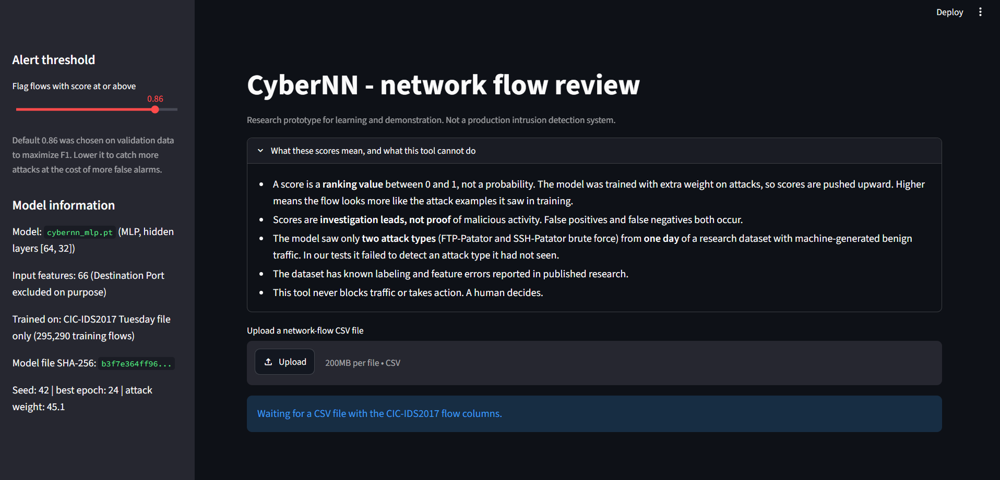
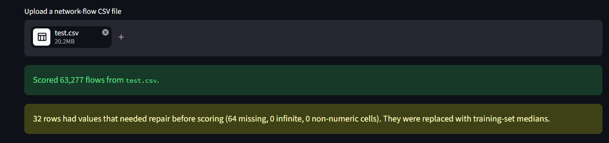
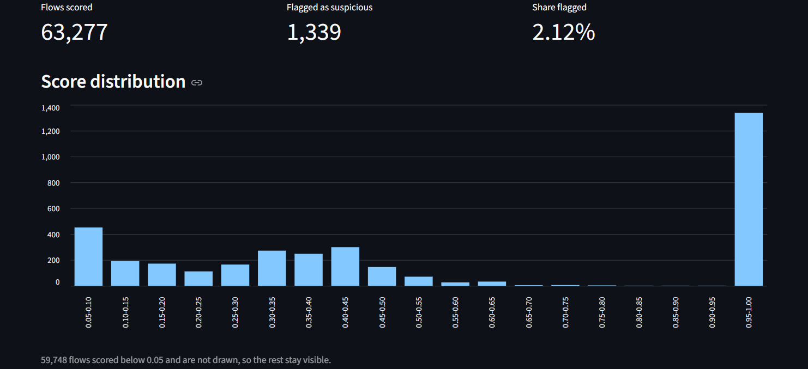
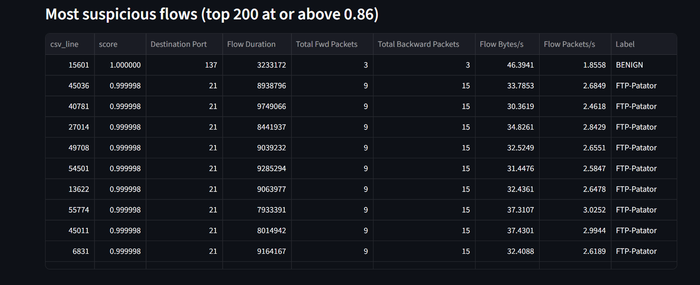
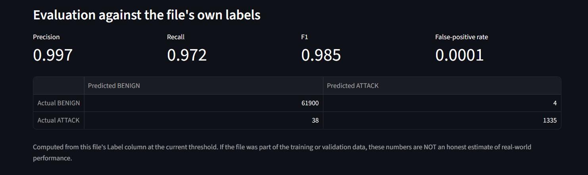
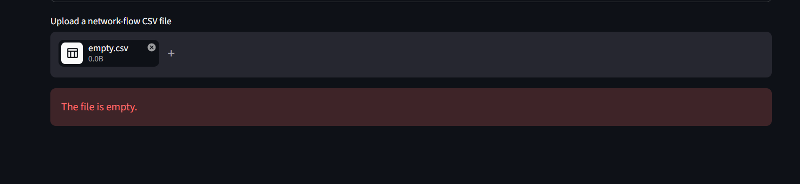

# CyberNN

An AI-assisted network intrusion detection prototype. A small neural network (a multilayer perceptron) learns from labeled network-flow records and gives each flow a score for how much it resembles the attacks it was trained on. A Streamlit dashboard lets an analyst upload a flow CSV, review the highest-scoring flows, and export an investigation summary.

> **Research prototype, not a production IDS.** CyberNN detects the attack families it was trained on (FTP and SSH brute force). In my tests it did **not** detect an attack family it had never seen: 0 of 128,016 DDoS flows. Scores are investigation leads, not proof of malicious activity. The tool never blocks traffic or takes any action.

## What it does

- Loads and validates labeled flow CSV files from the CIC-IDS2017 research dataset.
- Cleans the data without leaking test information: exact duplicates are removed before splitting, and every learned preprocessing step is fitted on the training split only.
- Trains a PyTorch MLP (66 -> 64 -> 32 -> 1, 6,401 parameters) on CPU and compares it with logistic regression and a random forest.
- Evaluates honestly: a test set kept sealed until the final evaluation, a held-out attack type, and two other days of the dataset the model never saw.
- Serves a Streamlit dashboard with upload validation, an adjustable alert threshold, a score chart, a table of the most suspicious flows, metrics and a confusion matrix when the file has labels, and exports (a flagged-flows CSV and a Markdown summary with SHA-256 fingerprints of the input and the model).
- Ships with 65 automated tests (pytest).

## Results at a glance

Test split: 63,277 flows, 1,373 of them attacks. Each model uses the threshold chosen on validation data.

| Model | Threshold | Precision | Recall | F1 | False alarms | Missed attacks |
|---|---|---|---|---|---|---|
| Logistic regression | 0.95 | 0.950 | 0.964 | 0.957 | 70 | 50 |
| Random forest | 0.28 | 0.997 | 0.999 | 0.998 | 4 | 2 |
| CyberNN MLP | 0.86 | 0.997 | 0.972 | 0.985 | 4 | 38 |

The random forest is better than the neural network on this split. This is reported as it is: tree ensembles often do very well on tabular data like this.

How the MLP behaves on data it was not trained on:

| Test | Result |
|---|---|
| Attack type held out of training (validation data, threshold 0.5) | Recall 0.304 on unseen FTP-Patator (271 of 890) and 0.004 on unseen SSH-Patator (2 of 483) |
| Another day, benign traffic only (Monday, 502,983 flows) | 99 false alarms at threshold 0.86, about 0.20 per 1,000 flows |
| Another day, a new attack family (Friday DDoS, 128,016 flows) | **0 detected** at thresholds 0.86 and 0.5 |
| Benign flows in that same Friday file (95,096 flows) | 26 false alarms at 0.86, about 0.27 per 1,000 flows |

Speed on CPU: about 8 ms per 1,000 flows including preprocessing.

## Design decisions worth knowing

- **The destination port is deliberately not a feature.** In the Tuesday file every FTP-Patator flow uses port 21 and every SSH-Patator flow uses port 22, so a model can score well by memorizing ports. Adding the port raised logistic regression's validation F1 from 0.784 to 0.988, which is shortcut learning, not detection skill.
- **Accuracy is not used to judge models.** Roughly 97 to 98% of flows are benign, so a model that never alerts scores that much accuracy. Precision, recall, F1, false-alarm rate and average precision are reported instead.
- **The score is a ranking value, not a probability.** The model is trained with extra weight on attacks, which pushes scores upward. The best threshold is 0.86, not 0.5.
- **The threshold is a decision, made on validation data, never on the test set.**
- **Duplicates are removed before splitting.** The raw Tuesday file keeps 24,065 duplicate rows. On the raw file recall is 0.730, against 0.972 on the de-duplicated test split. The likely reason is repeated, hard-to-detect fragment flows (a hypothesis I have not verified).

## Screenshots

The dashboard with the labeled test split uploaded, at the default threshold of 0.86.













## Quick start (Windows, PowerShell)

Tested with Python 3.12.10 on Windows. Training runs on CPU; no GPU is needed.

```
py -3.12 -m venv .venv
.venv\Scripts\Activate.ps1
python -m pip install -r requirements.txt
```

### 1. Get the dataset (not included in this repository)

Download **MachineLearningCSV.zip** (about 235 MB) from the CIC-IDS2017 page, https://www.unb.ca/cic/datasets/ids-2017.html, and save it in `data\raw`. Extract the Tuesday file:

```
tar -xf data\raw\MachineLearningCSV.zip -C data\raw MachineLearningCVE/Tuesday-WorkingHours.pcap_ISCX.csv
```

### 2. Run the pipeline

```
python scripts\inspect_dataset.py          # look at the raw file (read-only)
python scripts\prepare_data.py             # clean, de-duplicate, split 70/15/15
python scripts\build_preprocessor.py       # fit preprocessing on the training split
python scripts\train_baselines.py          # logistic regression and random forest (validation only)
python scripts\train_cybernn.py            # train and save the MLP
python scripts\unseen_attack_mlp.py        # hold-one-attack-out test
python scripts\final_test.py               # open the sealed test set once
python scripts\error_analysis.py           # study mistakes on validation data
```

Optional: `python scripts\build_preprocessor.py --keep-port` and `python scripts\train_baselines.py --keep-port` reproduce the port-shortcut experiment. To score another day of the dataset, extract its CSV and run `python scripts\score_other_day.py <path to the CSV>`.

### 3. Run the dashboard

```
python -m streamlit run app\cybernn_app.py --server.address localhost --browser.gatherUsageStats false
```

Then open http://localhost:8501 and upload a CSV, for example `data\processed\test.csv`. Binding to `localhost` keeps the app reachable only from your own PC.

### 4. Run the tests

```
python -m pytest -q
```

## Project layout

```
app\            Streamlit dashboard (cybernn_app.py)
src\cybernn\    data.py, preprocessing.py, model.py, training.py, evaluation.py, validation.py, report.py
scripts\        pipeline scripts above, plus early learning exercises (one_neuron.py, gradient_descent.py, ...)
tests\          65 pytest tests
models\         trained MLP (cybernn_mlp.pt + .json) and preprocessing (preprocessor.json)
reports\        loss curves, test confusion matrix, final_test_results.json
data\           not tracked: raw downloads and generated splits
```

## Security notes

- Uploaded files are untrusted: size and row limits (500,000 rows), clear errors for empty, unparseable and header-only files, and a required-column check.
- **CSV formula injection:** text cells and column names beginning with `=`, `+`, `-` or `@` get a leading apostrophe in exports, so a spreadsheet cannot run them as formulas. Checked with a deliberately malicious label in the browser.
- Preprocessing is stored as plain JSON, not pickle, and validated on load. Model weights are loaded with `weights_only=True`; a test shows that a file carrying code is refused and its code never runs.
- Every export records SHA-256 fingerprints of the uploaded file, the model and the preprocessor.
- The dashboard binds to localhost, and Streamlit's usage-statistics collection is turned off in the run command.

## Limitations

- Trained on two attack families (FTP-Patator and SSH-Patator) from one day of one dataset. It did not detect a new attack family (DDoS).
- The benign traffic is machine-generated by the dataset authors from simulated users, so false-alarm rates on a real network will differ.
- CIC-IDS2017 has labeling and feature-extraction problems reported in published research. Some "attack" flows are one-packet fragments that look like harmless traffic, and no behavior-based model can be expected to catch them.
- Results come from a single training run (seed 42); the variation between seeds was not measured.
- Most remaining false alarms come from a few benign behaviors (destination ports 465, 443, 389 and 80).
- It is a research prototype. Treat every score as a lead for a human analyst.

## Dataset and citation

CIC-IDS2017 is published by the Canadian Institute for Cybersecurity. Its page asks users to cite the dataset's paper. The data is not included here and has its own terms.

> Iman Sharafaldin, Arash Habibi Lashkari, and Ali A. Ghorbani, "Toward Generating a New Intrusion Detection Dataset and Intrusion Traffic Characterization", 4th International Conference on Information Systems Security and Privacy (ICISSP), Portugal, January 2018.

## Documentation

- [Architecture](docs/architecture.md): pipeline, dashboard flow, components, trust boundaries
- [Dataset notes](docs/dataset.md): source, license, schema, data quality, the port shortcut
- [Model card](docs/model_card.md): what the model is, how it was trained, where it fails
- [Evaluation](docs/evaluation.md): every result in one place
- [Limitations and failure cases](docs/limitations.md): ranked, with evidence
## Roadmap

- A FastAPI prediction service with input validation, structured errors and access controls
- Training on several attack families and evaluating on a held-out day
- A benign-only model (for example an autoencoder) for unseen attacks
- The secondary UNSW-NB15 dataset

## License

Code: MIT (see `LICENSE`). The dataset is not covered by this license.
