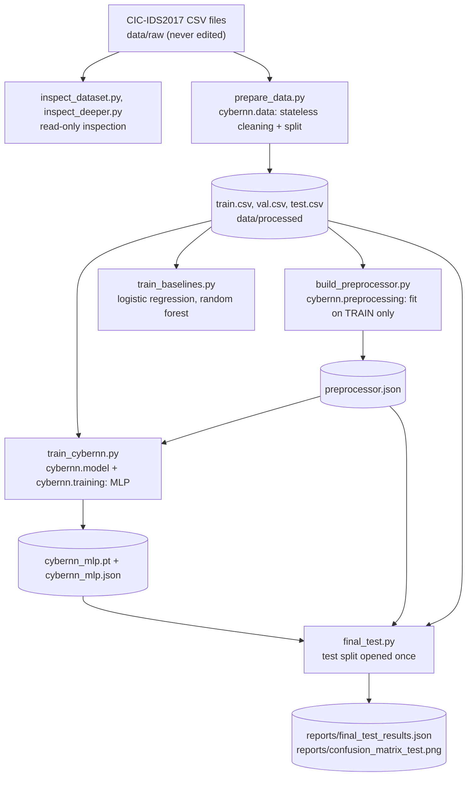
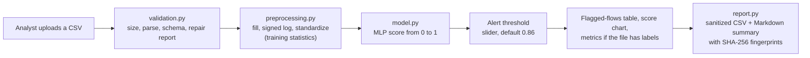

# Architecture

CyberNN has two parts: an **offline pipeline** that prepares data, trains models and evaluates them, and an **interactive dashboard** that applies the trained model to a file an analyst uploads. Nothing runs in the background, and nothing acts on a network.

## Offline pipeline (training and evaluation)

Rules the pipeline enforces:

- Steps that learn nothing from the data (stripping names, removing exact duplicates, turning infinities into missing values) run **before** the split. Steps that learn from data (medians, means, scales, which columns are constant) are fitted on the **training split only**.
- Validation data is used for choices: the alert threshold and early stopping. The test split is opened once, by `final_test.py`.
- Artifacts are saved in formats that cannot run code: preprocessing as plain JSON, model weights loaded with `weights_only=True`.

## Dashboard (inference)

## Components

| Module | Responsibility | Automated tests |
|---|---|---|
| `src/cybernn/data.py` | Load a flow CSV, clean it (stateless), split 70/15/15 | `tests/test_data.py` |
| `src/cybernn/preprocessing.py` | `Preprocessor`: fit, transform, save and load as JSON | `tests/test_preprocessing.py` |
| `src/cybernn/model.py` | Build the MLP, score in chunks, save and load safely | `tests/test_model.py` |
| `src/cybernn/training.py` | Class-weighted loss, Adam, mini-batches, early stopping | `tests/test_model.py` |
| `src/cybernn/evaluation.py` | Confusion counts, precision, recall, F1, false-positive rate, average precision | `tests/test_evaluation.py` |
| `src/cybernn/validation.py` | Validate uploads, count repairs, read ground-truth labels | `tests/test_validation.py` |
| `src/cybernn/report.py` | Sanitized exports, Markdown summary, SHA-256 | `tests/test_report.py` |
| `app/cybernn_app.py` | The Streamlit page that wires the modules together | Checked by hand in the browser; not automated |

There are 65 tests in total. The scripts in `scripts/` call these modules (`train_cybernn.py` also contains its own copy of the training loop) and are not unit-tested.

## Artifacts

| File | Produced by | Used by |
|---|---|---|
| `data/processed/train.csv`, `val.csv`, `test.csv` | `prepare_data.py` | `build_preprocessor.py`, `train_*.py`, `final_test.py`, `error_analysis.py` |
| `models/preprocessor.json` | `build_preprocessor.py` | `train_cybernn.py`, the dashboard, `final_test.py`, `score_other_day.py` |
| `models/preprocessor_with_port.json` | `build_preprocessor.py --keep-port` | `train_baselines.py --keep-port` (the port-shortcut experiment) |
| `models/cybernn_mlp.pt` and `.json` | `train_cybernn.py` | the dashboard, `final_test.py`, `error_analysis.py`, `score_other_day.py` |
| `reports/*` | `final_test.py`, `train_cybernn.py`, `prepare_data.py` | the documentation |

## Trust boundaries and controls

| Boundary | Risk | Control |
|---|---|---|
| Uploaded CSV enters the dashboard | Malformed, oversized or wrong-schema files | `validation.py`: clear errors, a 500,000-row limit, a required-column check, numeric coercion with every repair reported |
| Exported CSV is opened in a spreadsheet | Text such as `=HYPERLINK(...)` runs as a formula | `report.py`: cells and column names beginning with `=`, `+`, `-` or `@` get a leading apostrophe |
| Model and preprocessor files are loaded from disk | A tampered file that runs code or feeds bad numbers | Preprocessing is JSON and validated on load; weights are loaded with `weights_only=True` |
| The dashboard listens on a network port | Other machines reaching it | Started with `--server.address localhost` |
| A model output becomes an action | A false positive or false negative causes harm | No automatic action of any kind; a human reviews every flagged flow |

## Design decisions

- **The destination port is not a feature.** In the Tuesday file every FTP-Patator flow uses port 21 and every SSH-Patator flow uses port 22, so a model can score well by memorizing ports.
- **Duplicates are removed before splitting,** so identical rows cannot land in both training and test data.
- **Signed log, then standardization.** Flow features are heavy-tailed and some contain negative values, so a plain logarithm would fail.
- **Class weighting instead of resampling.** The attack class is about 2% of the data; the loss gives it extra weight (about 45 times).
- **A small MLP.** 66 inputs, two hidden layers of 64 and 32 units, 6,401 parameters, trained on CPU. Larger models were not tried.
- **The threshold is chosen on validation data.** It is a decision for the analyst, so the dashboard exposes it as a slider.

## Not built yet

A FastAPI prediction service, live traffic capture, SIEM integration and an automated retraining pipeline.
