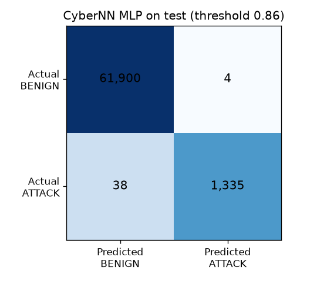

# Evaluation

Every result in this project, in one place. All numbers were produced by the scripts named in each section, on CIC-IDS2017 data (see `dataset.md`). Where something is a guess, it says so.

## How the evaluation was designed

- **Three splits.** The cleaned Tuesday file was split 70/15/15 (train 295,290, validation 63,277, test 63,277), stratified by attack type, seed 42.
- **Choices are made on validation data only:** the alert threshold (best F1 on a grid from 0.05 to 0.95) and early stopping. The **test split was evaluated once**, by `final_test.py`. It was used again only to check that the dashboard reproduces the same numbers; no model, threshold or code changed because of it.
- **Every model gets the same treatment:** logistic regression, a random forest (100 trees) and the CyberNN MLP are trained on the training split only, with extra weight on attacks.
- **Metrics:** precision, recall, F1, false-positive rate, the confusion matrix and average precision. Accuracy is not used: 97 to 98% of flows are benign, so a model that never alerts would score that.
- **Fresh data:** two other days of the dataset (Monday and Friday) were scored without any tuning on them.

## 1. Baselines and the MLP on validation data (threshold 0.5, port excluded)

Script: `train_baselines.py` and `train_cybernn.py`.

| Model | Precision | Recall | F1 | False alarms | Missed | Average precision |
|---|---|---|---|---|---|---|
| Logistic regression | 0.653 | 0.981 | 0.784 | 717 | 26 | 0.952 |
| Random forest | 1.000 | 0.993 | 0.997 | 0 | 9 | 1.000 |
| CyberNN MLP | 0.904 | 0.990 | 0.945 | 144 | 14 | 0.996 |
| CyberNN MLP at 0.86 (chosen on validation) | 0.993 | 0.977 | 0.985 | 9 | 31 | 0.996 |

- There was no overfitting gap for logistic regression (F1 0.774 on train, 0.784 on validation). The forest scores 1.000 on train and 0.997 on validation, a small gap.
- At threshold 0.5 the comparison understated logistic regression: class weighting pushes every model's scores upward, so 0.5 is a poor cutoff for all of them. Section 3 compares models at their own validation-chosen thresholds, which is the fair comparison.
- Training the MLP took about 104 seconds on CPU: best epoch 24, early stopping at epoch 29. Training loss fell steadily (0.176 to about 0.039); validation loss was noisy (0.032 to 0.059) without a clear upward trend. Loss curves: `reports/cybernn_loss_curves.png`.

## 2. The port shortcut (validation data, threshold 0.5)

| Model | Port as a feature | Precision | Recall | F1 | False alarms |
|---|---|---|---|---|---|
| Logistic regression | no | 0.653 | 0.981 | 0.784 | 717 |
| Logistic regression | yes | 0.977 | 0.999 | 0.988 | 33 |
| Random forest | no | 1.000 | 0.993 | 0.997 | 0 |
| Random forest | yes | 0.999 | 0.999 | 0.999 | 1 |

In the Tuesday file every FTP-Patator flow uses port 21 and every SSH-Patator flow uses port 22, so a model that sees the port can partly memorize it. The linear model gained a great deal from the port; the forest barely changed. Dropping the port does not guarantee a port-free model, because other features may carry protocol fingerprints (not tested).

## 3. Final test split (63,277 flows, 1,373 attacks)

Script: `final_test.py`. Each model at 0.5 and at the threshold chosen on validation.

| Model | Threshold | TP | FP | FN | TN | Precision | Recall | F1 | FPR | AP |
|---|---|---|---|---|---|---|---|---|---|---|
| Logistic regression | 0.5 | 1,346 | 747 | 27 | 61,157 | 0.643 | 0.980 | 0.777 | 0.0121 | 0.970 |
| Logistic regression | 0.95 | 1,323 | 70 | 50 | 61,834 | 0.950 | 0.964 | 0.957 | 0.0011 | 0.970 |
| Random forest | 0.5 | 1,364 | 0 | 9 | 61,904 | 1.000 | 0.993 | 0.997 | 0.0000 | 1.000 |
| Random forest | 0.28 | 1,371 | 4 | 2 | 61,900 | 0.997 | 0.999 | 0.998 | 0.0001 | 1.000 |
| CyberNN MLP | 0.5 | 1,353 | 127 | 20 | 61,777 | 0.914 | 0.985 | 0.948 | 0.0021 | 0.989 |
| CyberNN MLP | 0.86 | 1,335 | 4 | 38 | 61,900 | 0.997 | 0.972 | 0.985 | 0.0001 | 0.989 |

Recall by attack family at the validation-chosen thresholds: logistic regression FTP 0.987 and SSH 0.921; random forest FTP 0.999 and SSH 0.998; CyberNN MLP FTP 0.993 and SSH 0.934.



- **Test matches validation.** The MLP's F1 is 0.985 on both. At 0.5, no model's F1 moved by more than 0.01. There is no sign that validation was optimistic.
- **The threshold matters a lot.** Logistic regression's F1 rises from 0.777 to 0.957 by moving the threshold from 0.5 to 0.95. Its best threshold sits at the edge of the search grid, so a higher one might be better.
- **The random forest is best on this split** (F1 0.998, 2 missed attacks). The MLP raises the same 4 false alarms but misses 38 attacks. A recall gap of 0.972 against 0.999 is probably real on this split, though flows from one session are correlated, so the uncertainty is larger than a simple count suggests.
- **The operating point is a choice.** At 0.5 the MLP catches 1,353 attacks at the cost of 127 false alarms; at 0.86 it catches 1,335 with 4 false alarms.

## 4. An attack type held out of training (validation data, threshold 0.5)

Script: `unseen_attack_test.py` and `unseen_attack_mlp.py`. For each round, one attack type is removed from the training data and the preprocessor is refitted without it. Evaluation uses benign flows plus the held-out attack only.

| Unseen attack | Model | Detected | False alarms | Recall | Average precision |
|---|---|---|---|---|---|
| FTP-Patator | Logistic regression | 273 of 890 | 1,624 | 0.307 | 0.207 |
| FTP-Patator | Random forest | 0 of 890 | 0 | 0.000 | 0.860 |
| FTP-Patator | CyberNN MLP | 271 of 890 | 1,540 | 0.304 | 0.352 |
| SSH-Patator | Logistic regression | 0 of 483 | 86 | 0.000 | 0.045 |
| SSH-Patator | Random forest | 1 of 483 | 0 | 0.002 | 0.014 |
| SSH-Patator | CyberNN MLP | 2 of 483 | 17 | 0.004 | 0.006 |

- The forest ranked unseen FTP-Patator flows well (average precision 0.860) but scored them below 0.5. A lower threshold would catch many, but choosing it requires knowing about the attack in advance.
- Nothing generalized to unseen SSH-Patator; the MLP's average precision is at or below the random level (about 0.008).
- With the port kept, logistic regression and the MLP detected 890 and 889 of 890 unseen FTP-Patator flows. A plausible explanation (not tested) is that port 21 sits numerically next to port 22, the SSH attack port, which a smooth model treats as similar. If so, it is a coincidence of numbering and not detection skill.
- Each round is a single run on two held-out cases: a lead, not a conclusion.

## 5. Fresh days (no tuning on these data)

Script: `score_other_day.py`.

| File | Flows (after de-duplication) | Result at 0.86 | Result at 0.5 |
|---|---|---|---|
| Tuesday validation (shares a day with training) | 61,904 benign | 9 false alarms (0.15 per 1,000) | 144 (2.33 per 1,000) |
| Monday (benign only) | 502,983 | 99 false alarms (0.20 per 1,000) | 986 (1.96 per 1,000) |
| Friday afternoon, benign flows | 95,096 | 26 false alarms (0.27 per 1,000) | 202 (2.12 per 1,000) |
| Friday afternoon, **DDoS** | 128,016 | **0 detected** | **0 detected** |

- The false-alarm rate on new benign days is close to the validation figure. The validation estimate rested on only 9 alarms, so the larger Monday sample is more trustworthy.
- Most Monday false alarms come from a few ports: 443 (37), 465 (34), 389 (4), 80 (4). Ports 465 and 389 recur on all three days.
- **The model detected none of the DDoS flows.** The median score is below 0.00005, so it is not a threshold problem. The scoring path works: the benign flows in the same file behave like the other days. Why the DDoS flows look normal to the model was not examined.

## 6. The raw Tuesday file, with duplicates (dashboard upload)

445,909 flows at threshold 0.86: precision 0.993, recall 0.730, F1 0.841, false-positive rate 0.0002. Confusion: TN 431,998, FP 76, FN 3,737, TP 10,098.

The model trained on part of this file, so these numbers are not an honest estimate. They also show how file composition changes metrics: recall is 0.730 here and 0.972 on the de-duplicated test split. A likely reason (not verified) is that repeated copies of the hard-to-detect fragment flows dominate the miss count: the raw file keeps 24,065 duplicates, including 4,683 attack rows.

## 7. Error analysis (validation data, threshold 0.86)

Script: `error_analysis.py`. 31 attacks were missed (27 SSH-Patator, 4 FTP-Patator) and 9 benign flows were flagged.

| Attack | Outcome | Duration | Packets forward / backward | Bytes per second | Initial window |
|---|---|---|---|---|---|
| FTP-Patator | caught (886) | about 8.7 s | 9 / 15 | 33.8 | 29,200 |
| FTP-Patator | missed (4) | 63.5 microseconds | 1 / 1 | 0 | 229 |
| SSH-Patator | caught (456) | about 12 s | 21 / 32 | 394.5 | 29,200 |
| SSH-Patator | missed (27) | 97 microseconds | 1 / 1 | 0 | 259 |

Caught attacks look like full brute-force sessions. Most missed attacks are one-packet-each-way flows lasting microseconds. The explanation that those flows are labeled attacks but look harmless is a hypothesis. Five of the nine false alarms are nearly identical flows on port 465; two are microsecond flows on port 389.

## 8. Speed

About 8 ms per 1,000 flows end to end (preprocessing plus scoring) on a CPU. Scoring alone takes about 0.1 ms per 1,000 flows. This was measured on one batch.

## 9. Dashboard and code checks

- **Dashboard against the scripts:** uploading the test split at the default threshold reproduces `final_test.py` exactly (1,339 flagged; confusion 61,900 / 4 / 38 / 1,335), and so does the 0.50 setting (1,480 flagged; 61,777 / 127 / 20 / 1,353).
- **Bad files:** an empty file, an unparseable file and a header-only file each give a clear message without a crash.
- **Formula protection:** a flow labeled `=1+1` appears in the export as `'=1+1`, and no other cell in that file changed.
- **Fingerprints:** the file, model and preprocessor SHA-256 values shown by the dashboard match values computed independently with `Get-FileHash`.
- **Automated tests:** 74 pytest tests pass. The dashboard page itself is checked by hand, not automatically.

## What this evaluation cannot tell us

- How the model behaves on a real network, on other attack families, or against an attacker who adapts.
- How much results vary between training runs: one seed was used.
- Whether labels are correct: the dataset has reported errors that were not audited here.

## Reproduce

```
python scripts\prepare_data.py
python scripts\build_preprocessor.py
python scripts\train_baselines.py
python scripts\train_cybernn.py
python scripts\unseen_attack_test.py
python scripts\unseen_attack_mlp.py
python scripts\final_test.py
python scripts\error_analysis.py
python scripts\score_other_day.py data\raw\MachineLearningCVE\Monday-WorkingHours.pcap_ISCX.csv
python -m pytest -q
```
